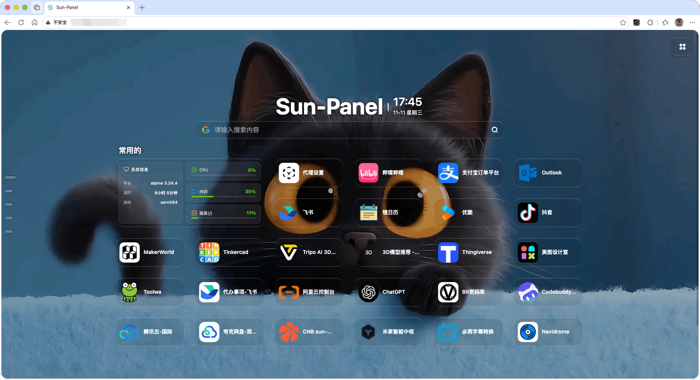
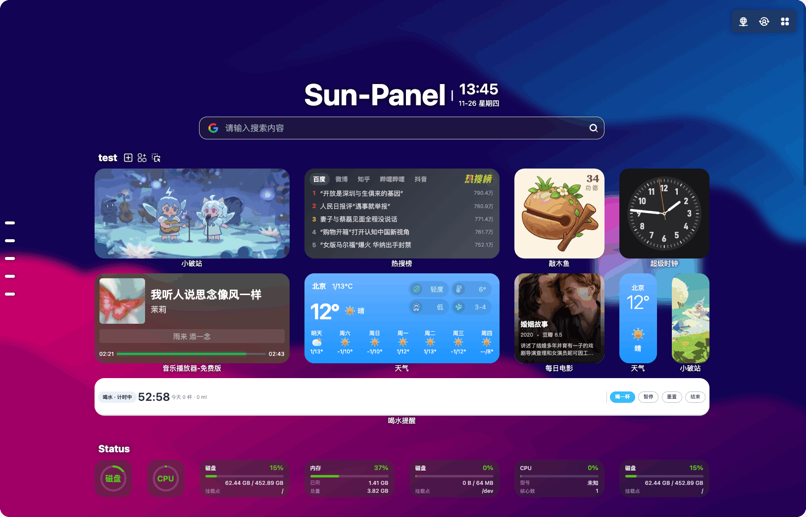
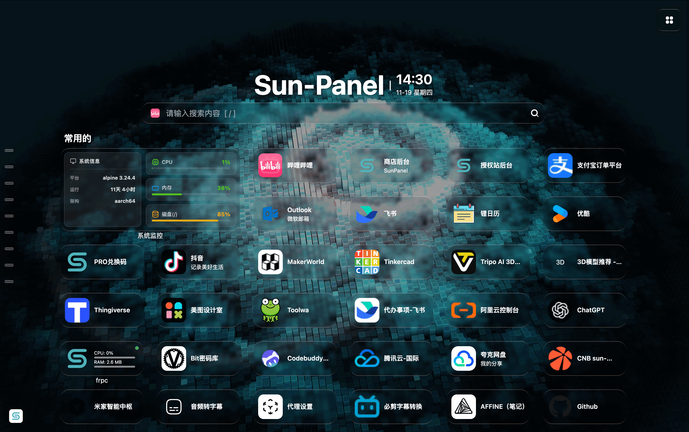
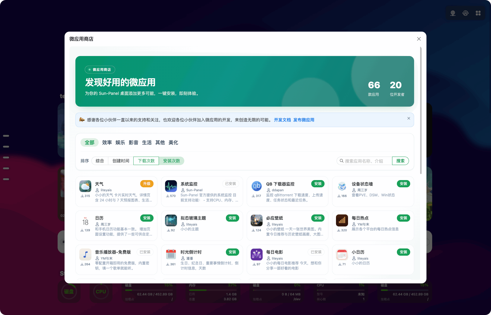
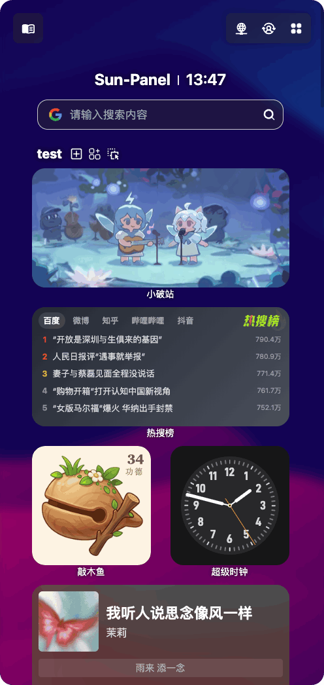
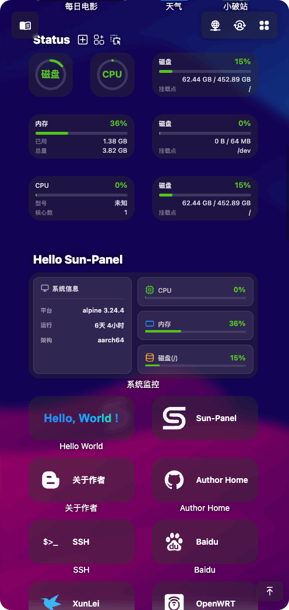

---
# https://vitepress.dev/reference/default-theme-home-page
layout: home

hero:
  name: "Sun-Panel V2"
  text: "Simple, Easy to Use, Attractive"
  tagline: "v2.0.2 released · New micro-app/widget framework, redesigned navigation, and video wallpapers"
  actions:
    - theme: brand
      text: Explore V2
      link: /introduce/project_v2

    - theme: alt
      text: Quick Deployment
      link: /usage/quick_deploy

    - theme: alt
      text: Download
      link: https://github.com/hslr-s/sun-panel/releases
    
    - theme: alt
      text: v1
      link: /introduce/project

  image:
    src: /images/introduce/main-dark-v2.webp
    alt: Sun-Panel V2

features:

  - icon:
     src: /images/index_home/f_concise.png
    title: Redesigned Navigation
    details: Mixed card sizes, cross-group drag and drop, and a mobile-friendly layout.
  - icon:
     src: /images/index_home/f_extension.png
    title: <a href="//appstore.sun-panel.top">Micro-Apps / Widgets</a>
    details: Install, uninstall, check for updates, and upgrade versions; developers can build their own.
  - icon:
     src: /images/index_home/f_video.png
    title: Video Wallpapers
    details: Upload any video as the page background for a more dynamic homepage.
  - icon:
     src: /images/index_home/f_network.png
    title: Smart Network Selection
    details: Match internal addresses based on the current URL; custom card addresses support right-click actions.
  - icon:
     src: /images/index_home/f_docker.png
    title: Docker Manager
    details: Card-based container status with real-time network speed and total traffic.
  - icon:
     src: /images/index_home/f_code.png
    title: Import/Export & Custom Code
    details: Share .zip configurations by group, use the snippet manager and marketplace, and enjoy multilingual UI.

---

----

\- **It's finally here after a year — see what's new in Sun-Panel V2** -

  <iframe src="https://player.bilibili.com/player.html?bvid=BV1Js486QE1w&amp;page=1&amp;high_quality=1&amp;danmaku=0" style="position:absolute;top:0;left:0;width:100%;height:100%;border:0;" scrolling="no" allowfullscreen></iframe>

  <a href="https://www.bilibili.com/video/BV1Js486QE1w/" target="_blank" rel="noopener">Watch the full video on Bilibili</a>

\- **All-new V2 interface, freely combined** -

  
  

<LangChange/>

