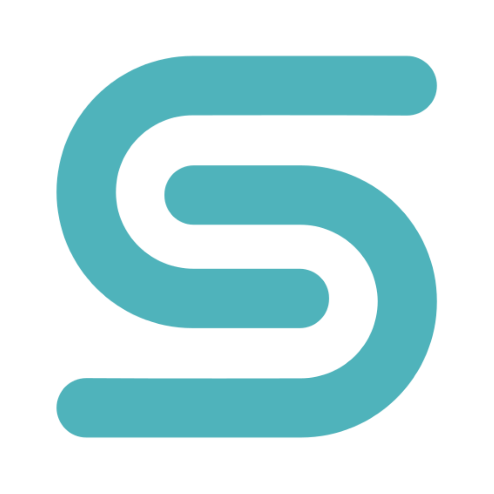
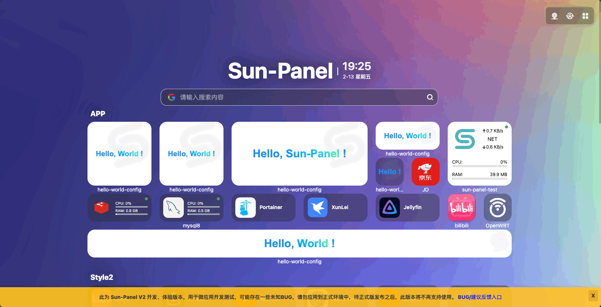
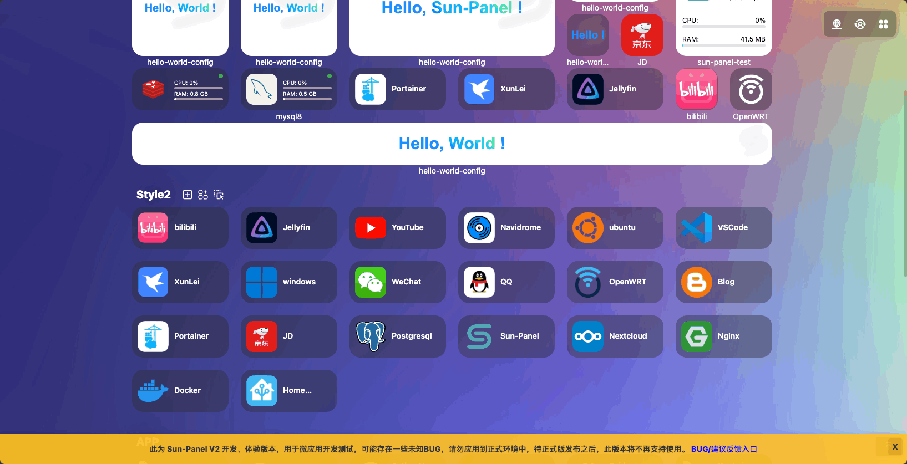
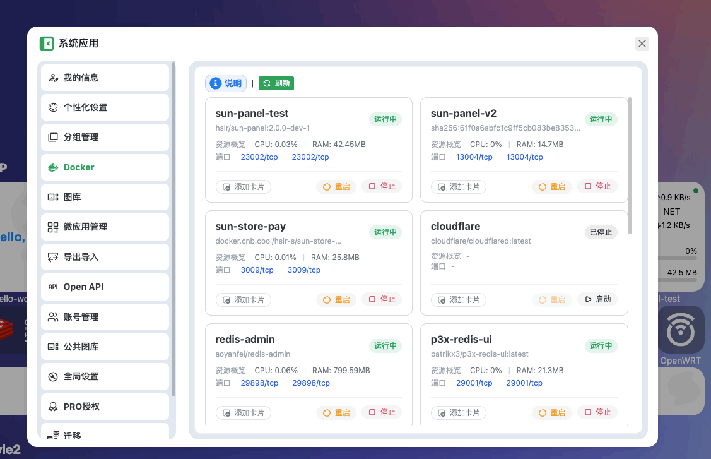
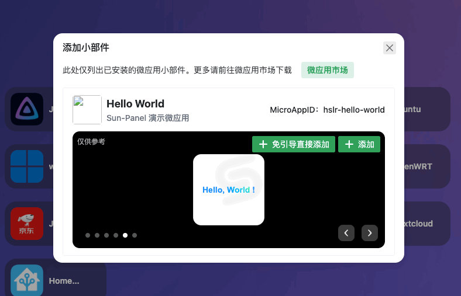
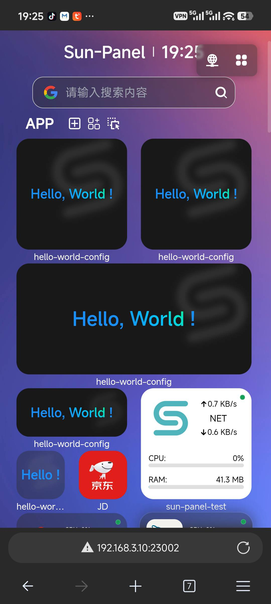
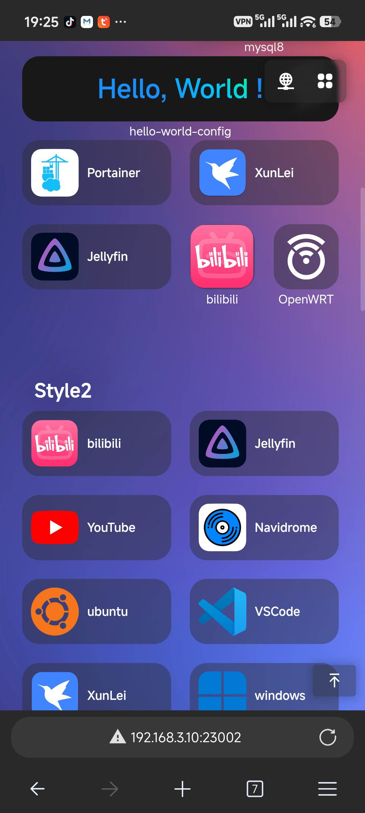

# Sun-Panel

 
 
 
 

A NAS, server navigation panel, easy Docker manager, Homepage, and browser start page. V2 builds on all of V1's capabilities, bringing a brand-new micro-app/widget framework, a redesigned navigation page, and richer card sizes.

## Features

- 🍉 Clean interface, powerful functionality, low resource consumption (inherited from V1)
- 🍊 Easy to use, visual operation, zero-code usage
- 🍠 One-click switch between internal and external network modes
- 🍵 Supports Docker deployment (compatible with Arm systems)
- 🎪 Supports multi-account isolation
- 🎏 Supports viewing system status
- 🫙 Supports custom JS, CSS
- 🍻 Simple usage without the need to connect to an external database
- 🍾 Rich icon styles for free combination, supports [Iconify icon library](https://icon-sets.iconify.design/)
- 🐳 Simple Docker manager, support the opening and shutdown of the container, control the container
- ✨ **Micro-App / Widget Card Framework**: unlimited playability in limited screen space, flexible install and uninstall, developers can freely build per the spec
- ✨ **Brand-new Network Environment Detection**: automatically matches the appropriate LAN / custom same-subnet address based on the current access URL
- ✨ **Custom Card Address**: participates in network environment detection for smart open or right-click menu open
- ✨ **Redesigned Navigation Page**: cross-group card dragging, mixed card sizes (`1x1`/`1x2`/`2x1`/`2x2`/`2x4`/`1x screen width`), perfect mobile widget adaptation, streamlined card DOM
- ✨ **Icon card supports remark text** (visible to logged-in users only)
- ✨ **Cross-platform binaries**: added Mac (arm64/amd64) using a pure-Go SQLite library
- ✨ **Smooth migration**: supports importing V1 icon config data, backup feature adapted
- ✨ **Batch delete for image library**
- ✨ **Enhanced version custom code**
- ✨ **Enhanced sharing feature**

## TODO

- [x] Micro-app/widget card framework
- [x] Brand-new network environment detection
- [x] Custom card address + network environment detection
- [x] Redesigned navigation page (cross-group drag, mixed sizes, mobile adaptation)
- [x] Docker manager changed to card style
- [x] All-new Docker card (real-time speed / cumulative traffic)
- [x] Icon card remark text
- [x] Mac binaries (arm64/amd64, pure-Go SQLite)
- [x] Import V1 icon config data
- [x] Backup feature adapted
- [x] Batch delete for image library
- [x] Sidebar directory (TOC)
- [x] V1 system status component adaptation
- [ ] Integrate third-party self-hosted icon library
- [ ] Batch modify icon cards

## Preview Screenshots

**Various styles, freely combined**

{style="max-width: 500px"}

{style="max-width: 500px"}
