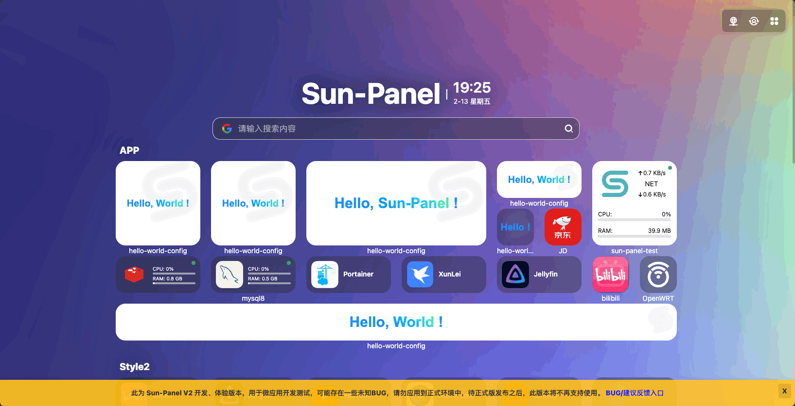
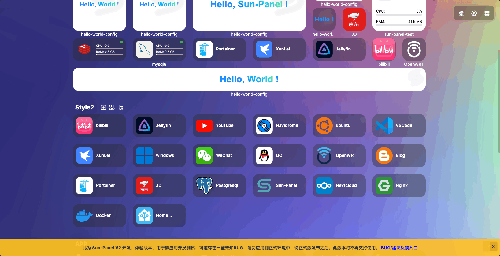
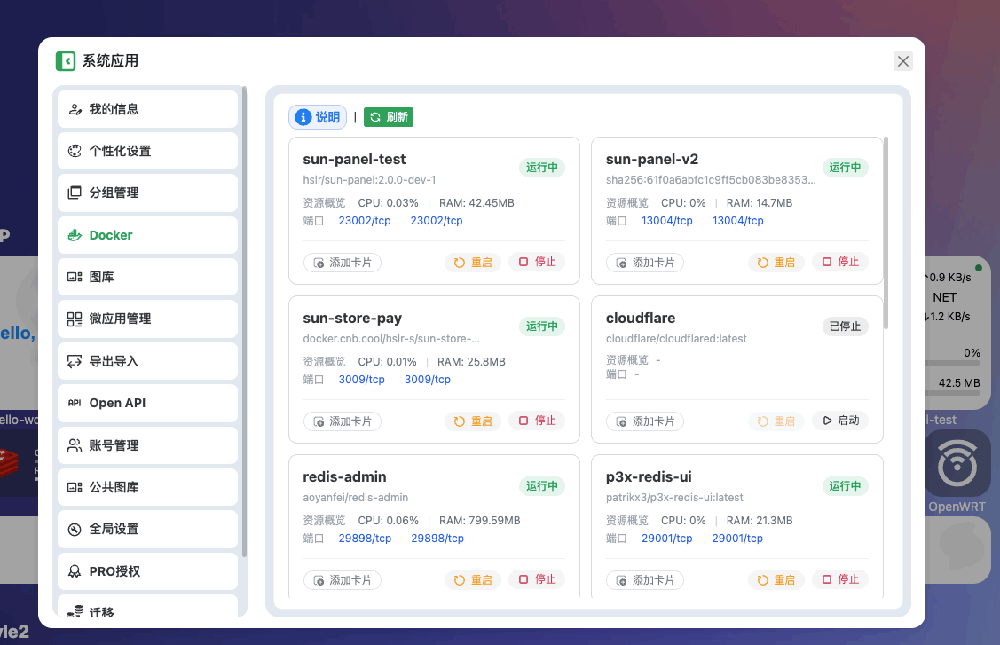
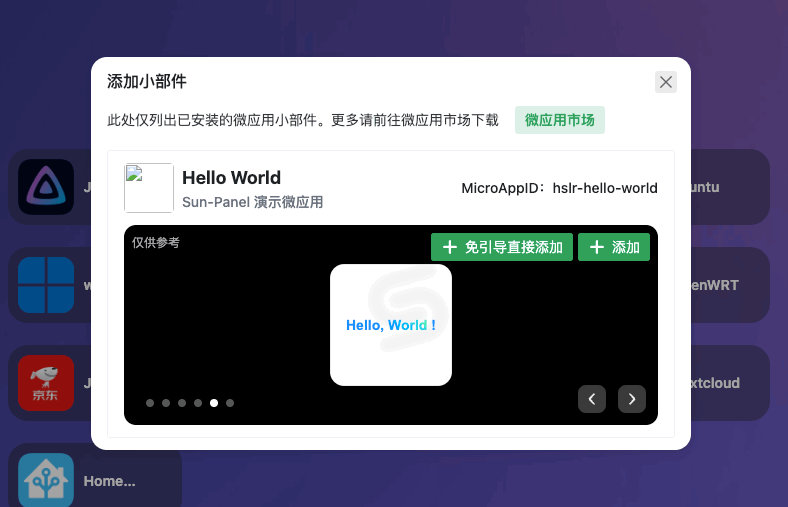
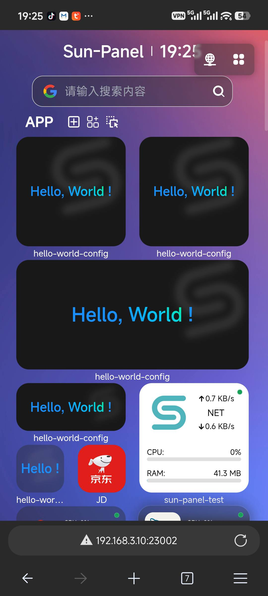
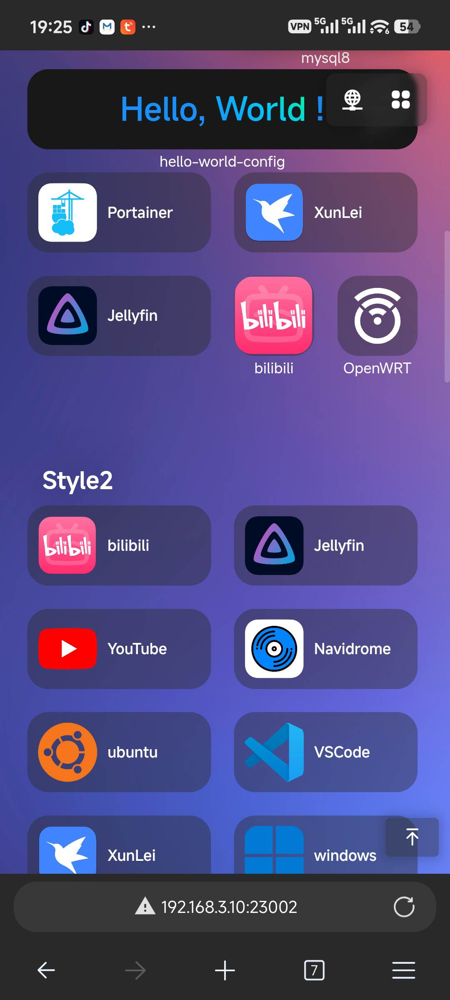

# Sun-Panel V2 Development Version Released

## BUG Feedback / Feature Suggestions / Testing Group
- V2 QQ Group: 924455282 (or `@author` in any Sun-Panel group, we listen to all suggestions)
- Feedback address: https://txc.qq.com/products/798902
- GitHub Issues: https://github.com/hslr-s/sun-panel/issues
- Micro app developers, add the author's WeChat (95302870), note: `micro app`, the author will add you to the developer group for better communication

## Important Notes for the Development Version
:::: danger ❗️❗️❗️❗️❗️ Must Read! Must Read! Must Read! ❗️❗️❗️❗️❗️
- The development version **has a development version note at the bottom**, please do not directly apply it in a public production environment.
- v2 is currently in the development and testing phase, and some uncontrollable BUGs may appear. If you pursue stability, especially **those who are new to AI, Docker, and NAS**, **we do not recommend trying the v2 development version**.
- The V2 development version already supports covering updates from V1 via upgrade, but the feature is still being tested. ❗️⚠️**Please do not follow this operation**⚠️❗️. Please use the v1 export backup package to restore and experience it in a separately deployed v2.
- After the test version (Beta) is released, the development version will only support offline use and cannot log in to the Sun-Panel PRO account, so please do not apply it in a production environment.
- A small number of v1 features have not yet been adapted in the first few versions, and will be gradually adapted later. Please refer to the feature list below.
::::

### Development Version Benefits
To release the official v2 version faster, we hope to invite more users to experience the new version's features. Therefore, for the development version (excluding the v2 test version for now), simply logging into the [Sun-Panel Service Platform](https://pro.sun-panel.top) account on the development version allows you to use PRO features for free and access advanced features.

During the development version (DEV) testing period, users who participate in testing and can propose effective BUGs (first-time proposals) will have their names publicly announced after the official version is released. Depending on the effective count, they can purchase a permanent PRO license at a discount (20% off / 50% off).

### Inviting Developers and AI Development Experts to Develop Micro Apps and Widgets
Refer to the documentation [Micro App Development](/micro_app_dev/index). The documentation is constantly being improved. Add the author's WeChat (95302870), note: `micro app`, the author will add you to the developer group for better communication.

## V2 Features
::::tip
The following lists the features completed compared to v1. Icon cards retain the v1 style while supporting more sizes for cards in the same group. Of course, there's much more than this; we've just picked a few simple ones. Suggestions are welcome!
::::

- ✅ Added micro app / widget card framework, enhancing infinite playability in limited screen space, with flexible installation and uninstallation. Developers who love development can freely develop according to the specifications.
- ✅ Brand new network environment detection solution, which can match the appropriate LAN address, custom address within the same network segment based on the current page access address.
- ✅ Added card custom addresses, which can participate in network environment identification for smart opening or right-click menu opening.
- ✅ Refactored the navigation page,
    - Cross-group card dragging
    - Support mixing different sizes (currently supports 【ratio (row x column)】`1x1`,`1x2`,`2x1`,`2x2`,`2x4`,`1xscreen width`). Micro app developers can refer to this config to develop widgets of different sizes.
    - Perfect mobile adaptation for widgets and other sized cards
    - Streamlined card DOM
- ✅ Docker manager changed from the original list to a card style, with better display effect
- ✅ Brand new Docker card, 2x2 card supports displaying container's real-time network speed and cumulative traffic.
- ✅ Icon cards support remark text, visible only when logged in.
- ✅ Binary files, added Mac (arm64, amd64) binary file support, removed cgo sqlite library support, adopted full Go sqlite library (binaries for all platforms not fully tested, feedback from testers appreciated, thank you)
- ✅ Import v1 icon config data
- ✅ Backup feature adaptation
- ✅ Gallery batch delete feature
- [ ] Integrate third-party self-hosted icon library
- [ ] Built-in features (docker, system monitoring, etc.) widgets
- [ ] Sidebar directory
- [ ] v1 version system status component adaptation
- [ ] More third-party micro app / widget adaptations
- [ ] More to come...

## Installation Method

:::: tip
Consistent with the [v1 installation method](/usage/quick_deploy). **This is a development version, currently incompatible with v1 data, please do not cover update and apply it in a production environment** ::::

- Development version pull command `docker pull hslr/sun-panel:2.0.1-dev-latest`
    The document update may not be timely. The docker tag name can be found in the v2 test group announcement. Or refer to the docker official site: https://hub.docker.com/r/hslr/sun-panel/tags
- Binary file download address: [Quark Drive](https://pan.quark.cn/s/74ece0eb087b)

## V2 Preview Images

{style="max-width: 500px"}

{style="max-width: 500px"}

