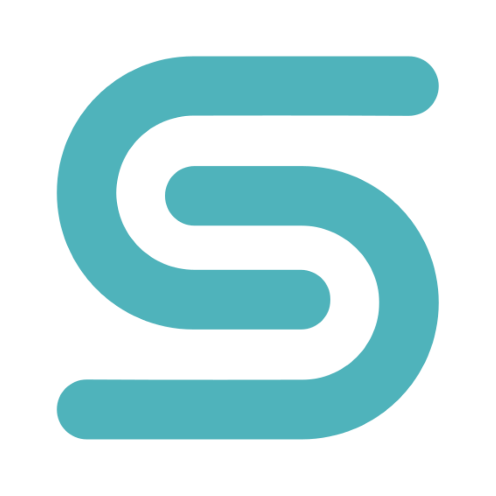
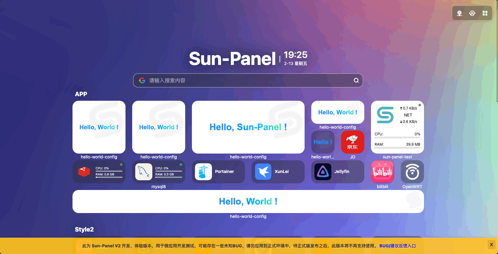
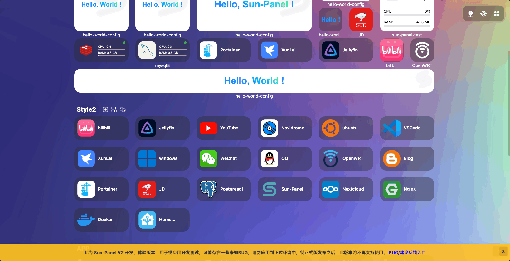
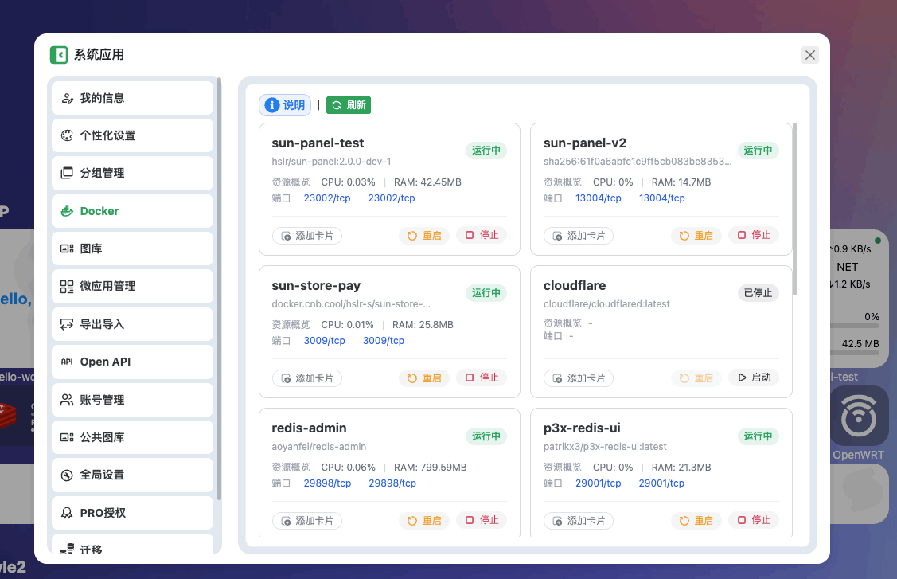
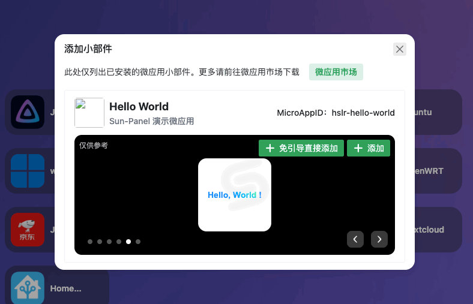
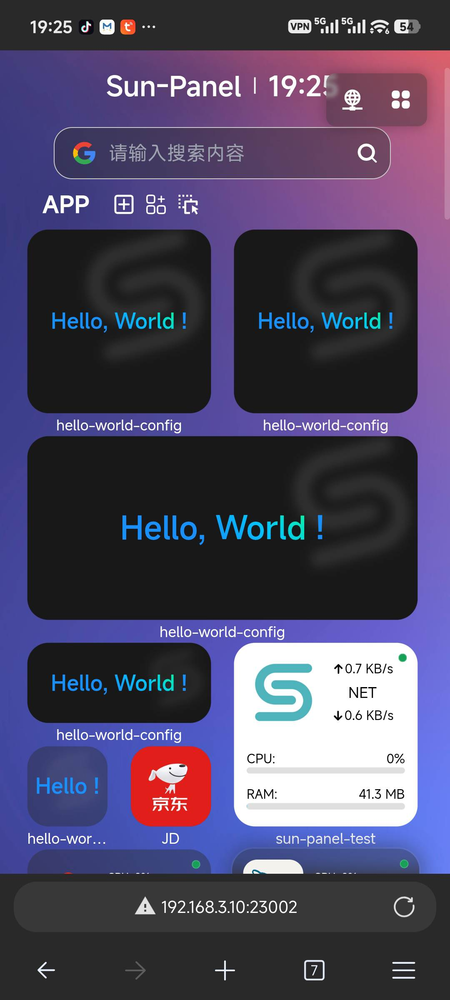
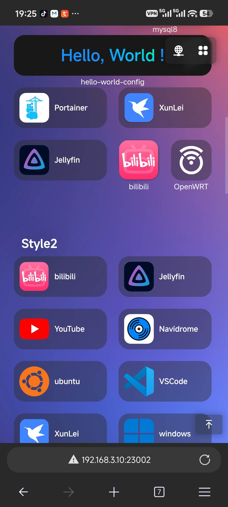

# Sun-Panel V2

 
 
 
 

一个NAS、服务器导航面板、简易docker管理器、Homepage、浏览器首页。V2 在保留 V1 全部能力的基础上，带来全新的微应用/小部件框架、重构的导航页面与更丰富的卡片尺寸。

## 特点

- 🍉 界面简洁，功能强大，资源占用少（继承自 V1）
- 🍊 上手简单，可视化操作，可0代码使用
- 🍠 一键切换内、外网模式链接
- 🍵 支持docker部署（支持Arm系统）
- 🎪 支持多账号隔离使用
- 🎏 支持查看系统状态
- 🫙 支持自定义js、css
- 🍻 简单使用可以无需连接外部数据库
- 🍾 丰富图标风格自由搭配，支持[iconify图标库](https://icon-sets.iconify.design/)
- 🐳 简单的docker管理器，支持查看容器状态、控制容器的开启和关闭
- ✨ **微应用 / 小部件卡片框架**：在有限的屏幕里提升无限可玩性，支持灵活安装和卸载，开发者可按规范自由开发
- ✨ **全新网络环境检测方案**：根据当前访问地址自动匹配合适的内网/自定义同网段地址
- ✨ **卡片自定义地址**：可参与网络环境识别，智能打开或右键菜单打开
- ✨ **重构导航页面**：支持跨分组拖拽卡片、不同尺寸卡片混用（`1x1`/`1x2`/`2x1`/`2x2`/`2x4`/`1x屏宽`）、手机端完美适配小部件
- ✨ **图标卡片支持备注文本**（仅登录可见）
- ✨ **全平台二进制**：新增 Mac 端（arm64/amd64），采用纯 Go SQLite 库
- ✨ **平滑迁移**：支持导入 V1 图标配置数据、备份功能适配
- ✨ **图库批量删除**
- ✨ **增强版本自定义代码**
- ✨ **增强分享功能**

## TODO

- [x] 微应用/小部件卡片框架
- [x] 全新的网络环境检测方案
- [x] 卡片自定义地址 + 网络环境识别
- [x] 重构导航页面（跨分组拖拽、多尺寸混用、手机端适配）
- [x] Docker 管理器改为卡片风格
- [x] 全新 Docker 卡片（实时网速/累计流量）
- [x] 图标卡片备注文本
- [x] Mac 端二进制支持（arm64/amd64，纯 Go SQLite）
- [x] 导入 V1 图标配置数据
- [x] 备份功能适配
- [x] 图库批量删除功能
- [x] 侧栏目录
- [x] V1 版本的系统状态组件适配
- [x] 更多三方适配微应用/小部件
- [ ] 对接三方自托管图标库
- [ ] 批量修改图标卡片

## 预览截图

**各种风格，自由搭配**

{style="max-width: 500px"}

{style="max-width: 500px"}
